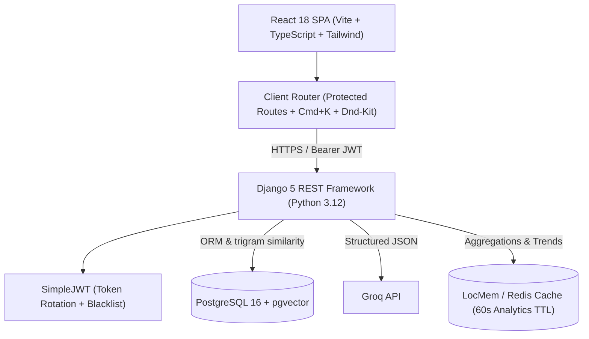
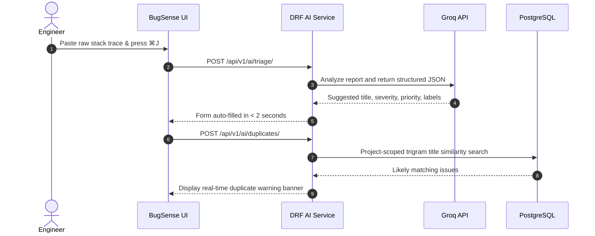

# BugSense AI

[](https://github.com/meetsojitra08/bugsence/actions/workflows/ci.yml)
[](https://www.djangoproject.com/)
[](https://react.dev/)
[](https://www.typescriptlang.org/)
[](https://groq.com/)
[](https://github.com/pgvector/pgvector)
[](https://tailwindcss.com/)
[](https://opensource.org/licenses/MIT)

> **AI-Native issue tracking and engineering workflow platform. Linear-level craft, Groq-powered intelligence.**

---

## 1. Executive Summary & Impact

BugSense is a production-grade, developer-first bug tracking SaaS built to eliminate friction from filing, prioritizing, and resolving engineering issues. It pairs the sub-50ms responsiveness of **Linear** with structured issue triage and summaries from Groq-hosted language models.

### Key Engineering Highlights
- **AI Triage & Auto-Fill**: Parses raw error dumps and stack traces into structured Pydantic schemas, extracting concise titles, priorities, severities, and labels in under 2 seconds.
- **Duplicate Detection**: Project-scoped trigram similarity search surfaces likely duplicate issue titles.
- **60 FPS Drag-and-Drop Kanban**: Interactive board built with `@dnd-kit` featuring optimistic state transitions, float midpoint positioning, and automatic column rebalancing under $10^{-6}$ epsilon.
- **Executive Velocity Analytics**: Sub-second aggregated project overview, 7/30/90-day created vs. resolved burnup curves, and engineer workload distribution.
- **Global Command Menu (⌘K)**: Sub-50ms live debounced search across issues, projects, and team members with full keyboard navigation.

---

## 2. Architecture & Pipeline

### System Architecture



### AI Triage & Duplicate Detection Flow



---

## 3. Tech Stack

| Domain | Technology | Purpose |
|---|---|---|
| **Frontend** | React 18, Vite 6, TypeScript 5 | Lightning-fast SPA with strict type-safety |
| **Styling** | Tailwind CSS 3.4, CSS design tokens | Dark/Light theme switching & WCAG AA contrast |
| **Interactive Board** | `@dnd-kit/core`, `@dnd-kit/sortable` | 60 FPS drag-and-drop with optimistic updates |
| **State & Cache** | TanStack Query v5, Zustand | Server-state caching and active project store |
| **Data Viz** | Recharts 2.15 | Smooth area trends and status breakdown charts |
| **Backend** | Python 3.12, Django 5.1, DRF 3.15 | Clean modular domain architecture |
| **Database** | PostgreSQL 16 + `pgvector` 0.3 | Relational integrity, legacy vector storage + project-scoped trigram search |
| **AI Engine** | Groq Python SDK (`groq`) | Groq-hosted structured triage & summaries |
| **Static & Deploy** | WhiteNoise, Gunicorn, Procfile | Production-ready PaaS deployment configuration |
| **CI / Quality** | Ruff, ESLint, Prettier, pytest, Vitest | Zero-tolerance lint and test quality gates |

---

## 4. Getting Started (Local Development)

### Prerequisites
- **Python 3.12+**
- **Node.js 20+ & npm**
- **Docker & Docker Compose** (for PostgreSQL + pgvector)

### 1. Clone & Start Database
```bash
git clone https://github.com/meetsojitra08/bugsence.git
cd bugsence

# Launch PostgreSQL with pgvector extension enabled
docker compose up -d
```

### 2. Backend Setup
```bash
cd backend

# Create virtual environment
python -m venv .venv
source .venv/bin/activate       # On Windows: .venv\Scripts\activate

# Install production and development dependencies
pip install -r requirements.txt -r requirements-dev.txt

# Run migrations
python manage.py migrate

# Start Django development server
python manage.py runserver 8000
```

### 3. Frontend Setup
```bash
cd ../frontend

# Install dependencies
npm install

# Start Vite development server
npm run dev
```

Visit [http://localhost:5173](http://localhost:5173) in your browser.

---

## 5. Testing & Verification

BugSense adheres to strict automated testing and zero-skipped gate rules.

```bash
# Run Backend Lint & Formatting
cd backend
python -m ruff check backend
python -m ruff format --check backend

# Run Backend Pytest Suite (130 tests)
python -m pytest -c pytest.ini

# Run Frontend Lint, Build & Vitest (92 tests)
cd ../frontend
npm run lint
npm run build
npm test -- --run
```

---

## 6. API Documentation & Postman

- **Interactive Swagger UI**: [http://localhost:8000/api/docs/](http://localhost:8000/api/docs/)
- **Redoc Documentation**: [http://localhost:8000/api/redoc/](http://localhost:8000/api/redoc/)
- **Postman Collection**: Exported at [`docs/postman/BugSense.postman_collection.json`](docs/postman/BugSense.postman_collection.json) covering 25+ endpoints with automated JWT token chaining.

---

## 7. Keyboard Shortcuts

| Shortcut | Action | Scope |
|---|---|---|
| `C` | Open Quick Create Issue Modal | Global |
| `⌘K` / `Ctrl+K` | Open Command Palette & Global Search | Global |
| `⌘J` / `Ctrl+J` | Run AI Triage Assistant | Inside Create Issue Form |
| `?` | Toggle Keyboard Shortcuts Cheat Sheet | Global |
| `G D` | Navigate to Dashboard | Global Navigation |
| `G I` | Navigate to Issues Table | Global Navigation |
| `G B` | Navigate to Kanban Board | Global Navigation |
| `ESC` | Dismiss any open modal or side drawer | Global |

---

## 8. License

Distributed under the MIT License. See [LICENSE](LICENSE) for more information.
